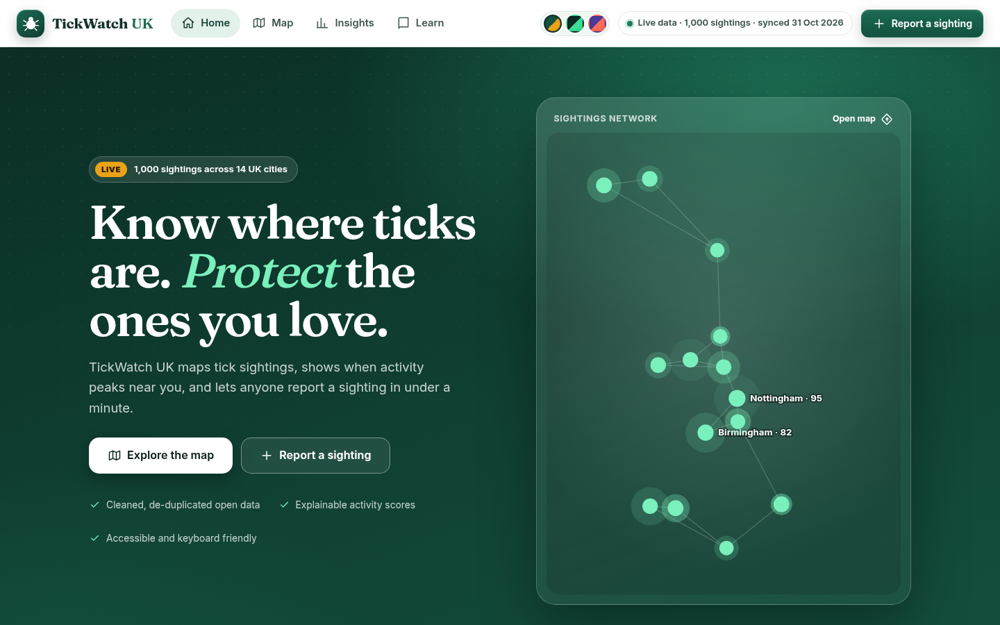
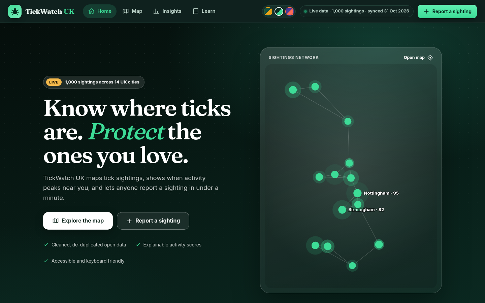
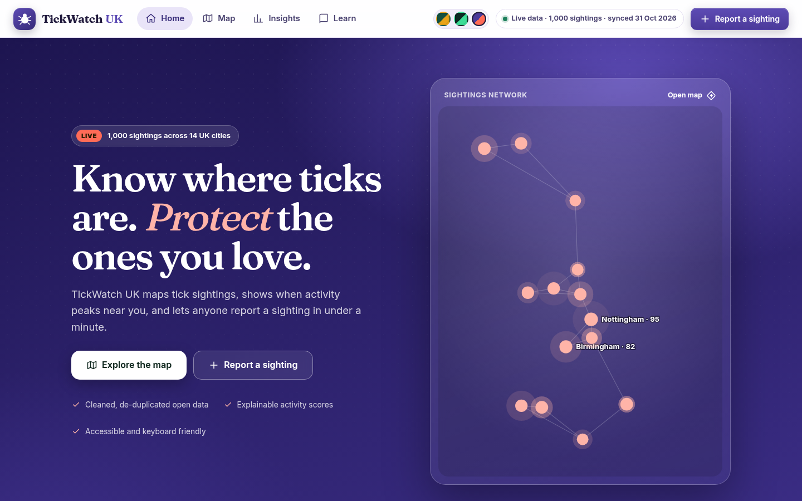
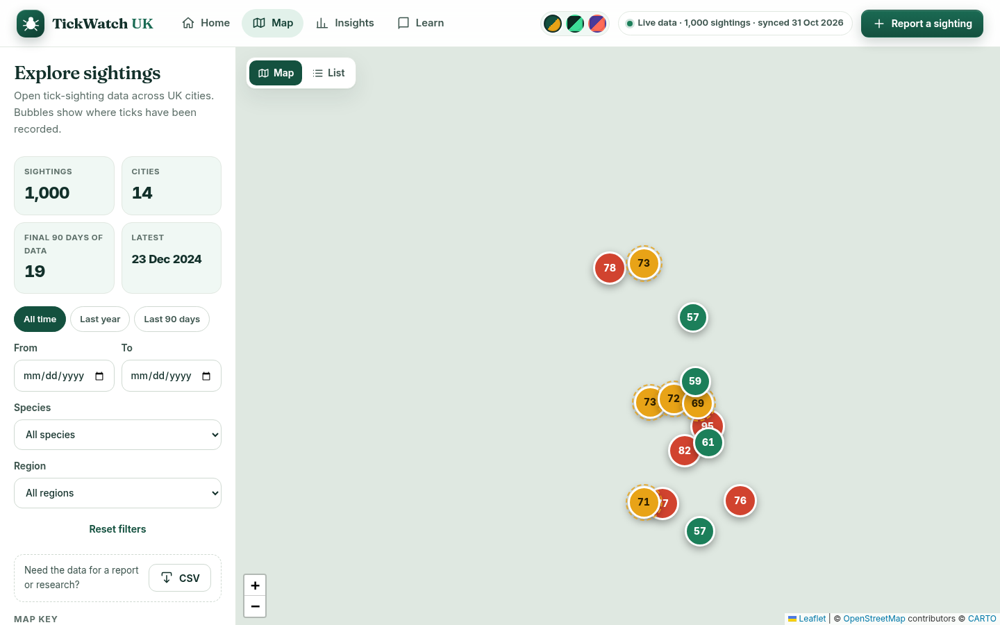
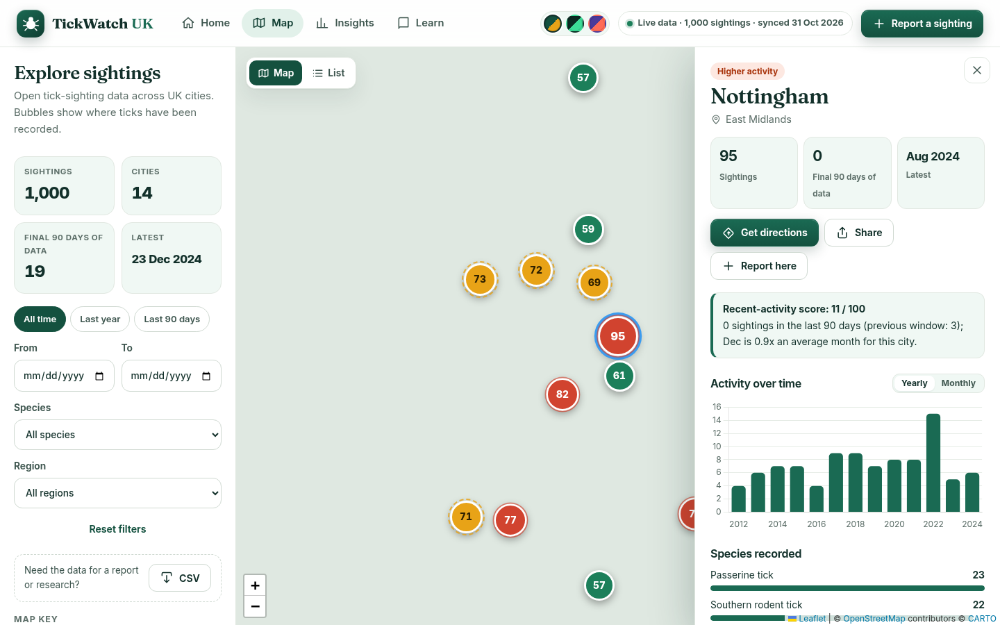
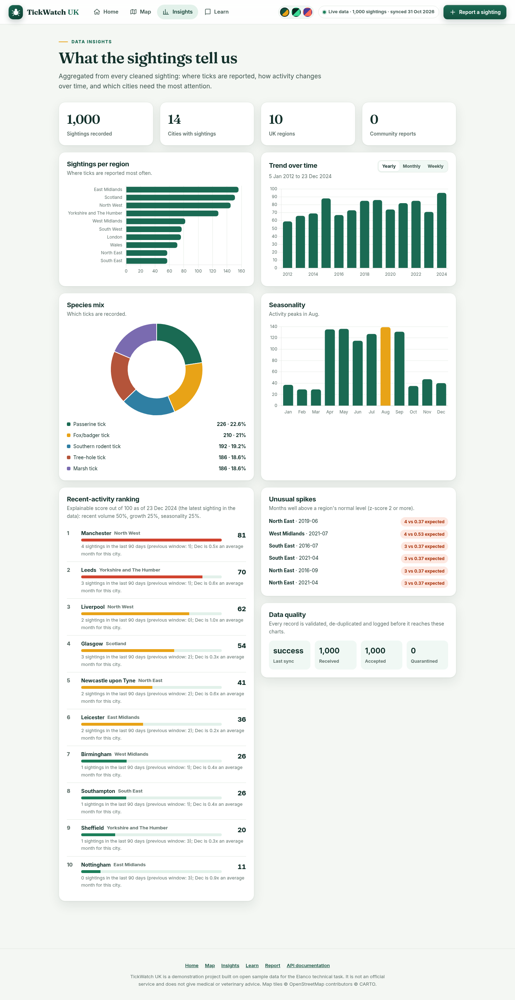
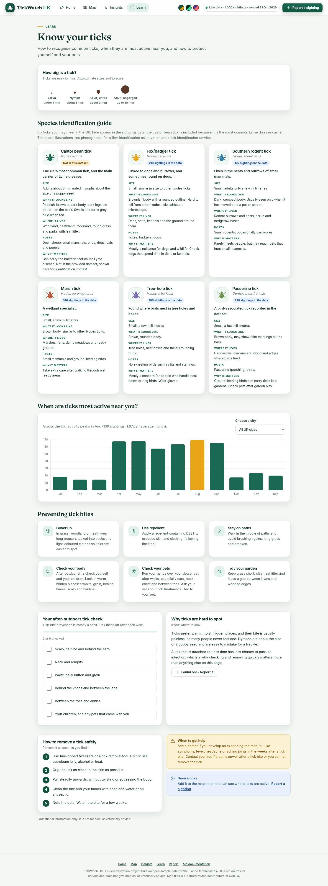
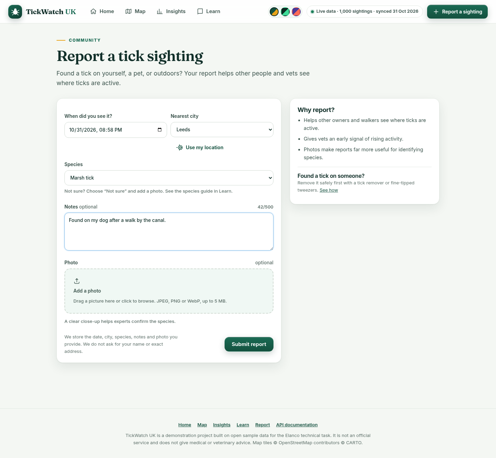
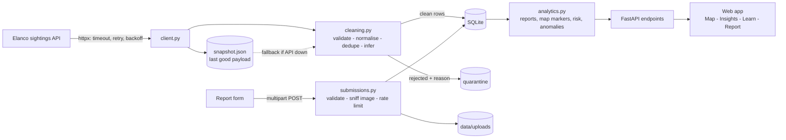
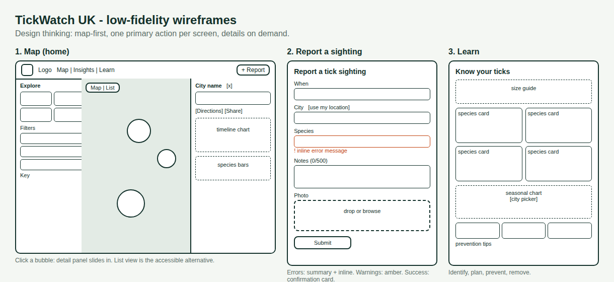

# TickWatch UK - Full-Stack Tick Tracker (MVP)

**Author:** Muhammad Hadi &nbsp;|&nbsp; Elanco Placement Programme technical task (Full Stack)

TickWatch UK is a web app that turns open tick-sighting data into something people can use: a **home page** with a personal "check your area" tool, an **interactive UK map**, **insight charts**, a **species and prevention guide**, and a **form to report new sightings with a photo**. It ships with **three colour themes** (Forest, Midnight dark, Heather). A Python/FastAPI backend ingests, cleans and serves the data; a lightweight JavaScript frontend consumes it.



> Python 3.11+ - FastAPI - SQLite - vanilla JS (ES modules) - Leaflet - Chart.js - pytest (43 tests) - Docker - GitHub Actions

---

## 1. Run it (macOS / Linux)

```bash
git clone https://github.com/engHADIuk/tickwatch-uk.git
cd tickwatch-uk
python3 -m venv .venv && source .venv/bin/activate
pip install -r requirements.txt

uvicorn app.main:app
```

Then open:

* **http://127.0.0.1:8000** - the web app
* **http://127.0.0.1:8000/docs** - interactive API documentation (Swagger)

On first start the backend downloads the dataset automatically (about a second). No Node.js, build step or API keys are needed: the frontend is plain HTML/CSS/JS served by FastAPI, and Leaflet and Chart.js are bundled in `frontend/vendor/`. The basemap tiles (CARTO / OpenStreetMap) need an internet connection.

```bash
pytest -q                                         # 43 tests, no network needed
python scripts/profile_data.py sightings.json     # profile a downloaded copy of the dataset
docker build -t tickwatch . && docker run -p 8000:8000 tickwatch   # optional
```

Settings can be changed with `TICK_*` environment variables or a `.env` file (see `.env.example`).

## 2. What is in the app

| Area (from the brief) | What I built |
|---|---|
| **Home page** (extra) | A landing page that opens first: live numbers, a **sightings network** of real cities (each point links to that city's map panel), a **"Check your area"** tool (pick a city and activity, get this month's historical tick activity and tailored tips), this month's national outlook, how it works, current hotspots, most-recorded species and a call to report. |
| **Three themes** (extra) | **Forest** (green and amber), **Midnight** (dark, mint accent, dark map tiles) and **Heather** (violet and coral). Chosen from the header, remembered between visits; charts, map tiles and every component follow the theme. Colour contrast was measured for every text pair in all three themes (all pass WCAG AA). Risk colours (green / amber / red) keep the same meaning in every theme. |
| **Interactive map** | Leaflet map of the UK, one bubble per city. **Size** = number of sightings, **colour** = activity relative to the other cities in view, plus a pulse ring (most) / dashed ring (moderate) so meaning never depends on colour alone. Filters: date range, quick ranges (all time / last year / last 90 days), species, region. A **List view** gives the same data as an accessible table. |
| **Sighting information** | Click or press Enter on a bubble: a side panel (bottom sheet on mobile) with KPIs, a recent-activity score with its explanation, a **yearly/monthly timeline chart**, species mix, seasonal pattern and a **timeline of the latest sightings** (with photos from community reports). Quick actions: **Get directions** (opens Google Maps), **Share** (native share sheet or copy link), **Report here**. A **CSV download** of the current filters is available for vets and researchers (spreadsheet-formula injection is neutralised). Every city has a deep link such as `#/map/Leeds`. |
| **Educational content** | A **species identification guide**, a tick size guide, **bite-prevention tips**, **safe removal steps**, when to seek help, and a **seasonal activity chart for any city**, and an interactive **after-outdoors tick-check checklist** with progress. |
| **Report a sighting** | Form with date/time, city (grouped by region, plus "Use my location"), species, notes and **photo upload** (drag and drop, preview, remove). Live validation with clear **error** (red, plus a summary that links to each field), **warning** (amber, e.g. very old sighting) and **success** states. Server errors (422, 409 duplicate, 429 rate limit, network) are all translated into friendly messages. |
| **Insights page** (extra) | Sightings per region, trends (yearly/monthly/weekly), species mix, seasonality, an explainable recent-activity ranking, unusual-spike detection and a live data-quality summary. |









## 3. Architecture



| File | Responsibility |
|---|---|
| `app/client.py` | Resilient upstream client (retries, backoff + jitter, `Retry-After`, pagination-ready) |
| `app/cleaning.py` | Validation, normalisation, de-duplication, gap inference |
| `app/ingest.py` | Pipeline: fetch -> snapshot -> clean -> upsert -> audit trail |
| `app/db.py` | SQLite schema, **self-migrating** columns, idempotent upserts, filter builder |
| `app/submissions.py` | Community reports: validation, image checks, rate limiting |
| `app/analytics.py` | Reports, map markers, trends, seasonality, risk score, anomalies |
| `app/geo.py`, `app/regions.py` | City coordinates and city -> UK region lookup |
| `app/content.py` | Species guide, prevention tips, removal steps |
| `app/errors.py` | One error envelope for every failure |
| `frontend/` | The web app: `index.html`, `assets/styles.css` (design system + 3 themes), `assets/js/` (`home`, `map`, `insights`, `learn`, `report`, shared utilities), bundled `vendor/` (Leaflet, Chart.js, Inter and Fraunces fonts, all with licences) |

### Key decisions (and why)

* **FastAPI + SQLite.** Typed validation, automatic OpenAPI docs, zero-setup storage with real SQL that ports to Postgres/PostGIS.
* **Ingest into a database instead of proxying the API.** Filters and aggregates become indexed SQL; the app keeps working when the source is down; the source is not hammered.
* **Design system with CSS variables.** Each theme is just a set of variables, so there is one stylesheet, no duplicated code, and charts read their colours from the same variables. Fonts (Inter for UI, Fraunces for headings) are bundled so the app looks identical offline.
* **Frontend served by the same app, no build step.** One command runs everything, reviewers can start it in seconds, and there is no toolchain to break. ES modules keep the code organised without a framework. React + Vite would be my choice for a larger team; for an MVP the trade-off favours simplicity and reliability.
* **City-level map.** The data has city names only, so each bubble is a city centroid. The UI says so explicitly rather than implying precision it does not have.
* **Relative colour scale.** The newest record in the sample data is from 2024, so "recent activity" is zero almost everywhere. Colouring bubbles by tertiles of the cities in view keeps the map informative under any filter; the explainable recent-activity score is shown separately.
* **Explainable analytics, not a black box.** About 1000 rows with no coordinates or weather would make a model overfit and be impossible to explain to a vet.

## 4. Data handling: large data, duplicates, incomplete data

* **Scale:** batches of 500 with `executemany`, indexed lookups, writes only new/changed rows; the client already follows `{"items": [...], "next": ...}` pagination.
* **Idempotent syncs:** `id` is the primary key and writes are upserts, so running `/sync` twice changes nothing. Community reports (`usr_...` ids) are never touched by a re-sync.
* **Duplicates** (all quarantined with a reason, never silently dropped): same id repeated (`duplicate_exact`), same id with changed content (`duplicate_id_conflict`), same event under a different id, including across syncs (`duplicate_content`). A community report that matches an existing sighting returns **409**.
* **Incomplete data:** reject only what breaks every query (`missing_id`, `missing_date`, `invalid_date`, `future_date`, `missing_location`); keep and flag the rest; infer species / Latin name from each other when the mapping is unambiguous; unknown cities are kept with region "Unknown".
* **Inspect it:** `GET /data-quality`, `GET /quarantine?reason=...`, `GET /sync/history`.

## 5. Error handling

* **Upstream failures:** hard timeouts; retries with exponential backoff and jitter on timeouts, connection errors, 5xx and truncated JSON; `Retry-After` honoured; 4xx fail fast. Every good payload is saved atomically as a snapshot; if the API is down `/sync` falls back to it (status `degraded`) and the app keeps serving data. The UI shows **"Live data"** or **"Offline mode"** in the header.
* **Invalid user submissions:** every problem is returned at once as `{field, problem}` pairs so the form can mark each field. Photos are checked by **content (magic bytes)**, not file name or declared type, and limited to 5 MB.
* **One error format everywhere:**
```json
{"error": {"code": "validation_error", "message": "Please fix the highlighted fields.",
           "details": [{"field": "date", "problem": "The sighting cannot be in the future."}], "request_id": "f1a4e057a560"}}
```
Codes: `validation_error` 422, `not_found` 404, `duplicate_report` 409, `sync_in_progress` 409, `rate_limited` 429 (with `Retry-After`), `upstream_unavailable` 502, `internal_error` 500.

## 6. API

| Method | Path | Purpose |
|---|---|---|
| POST | `/sightings` | **Submit a sighting** (multipart form: date, location, species, notes, image) |
| GET | `/sightings` | **Search/filter**: `start_date`, `end_date`, `location`, `region`, `species`, `q`, `sort`, `limit`, `offset` |
| GET | `/sightings/export` | **CSV download** of the filtered sightings |
| GET | `/sightings/{id}` | One sighting |
| GET | `/map/markers` | One marker per city (counts, recent activity, risk score) |
| GET | `/options`, `/education`, `/locations` | Dropdown values, learning content, cities |
| GET | `/reports/regions` | **Sightings per region** (or per city) |
| GET | `/reports/trends?interval=week\|month\|year` | **Trends over time** |
| GET | `/reports/species`, `/reports/seasonality` | Species breakdown, month-of-year pattern |
| GET | `/insights/risk`, `/insights/anomalies` | Explainable recent-activity score, spike detection |
| POST / GET | `/sync`, `/sync/history`, `/data-quality`, `/quarantine`, `/health` | Ingestion and observability |

All report endpoints accept the same date / location / region / species filters.

**Recent-activity score (0-100):** `100 x (0.50 x volume + 0.25 x growth + 0.25 x seasonality)`. *volume* = sightings in the last N days relative to the busiest city; *growth* = last window vs the one before; *seasonality* = how busy this calendar month usually is. Each result carries its components, evidence and a plain-English explanation. **Anomalies** are months whose count has a z-score of at least 2 within their own series.

## 7. Accessibility

Skip link; landmarks and one `h1` per view with focus moved on navigation; every control labelled; visible focus rings; map bubbles are keyboard focusable (Enter / Space opens details, Esc closes the panel and returns focus); a table **List view** replaces the map for people who cannot use it; errors are announced (`role="alert"`, `aria-live`) and linked from a summary; charts carry text summaries; colour is never the only signal; `prefers-reduced-motion` is respected; responsive down to phone width; measured WCAG AA contrast in all three themes; a dark theme for low-light and light-sensitive users.

## 8. Security notes

Read-only data API, parameterised SQL, CSV exports escape formula characters, notes rendered as text (never HTML), uploads validated by content, size-limited and stored under random names, `X-Content-Type-Options: nosniff`, per-client rate limiting on submissions, no secrets in the repo.

## 9. Testing

* `pytest -q` runs **43 tests** with no network: cleaning rules and every rejection reason, retries/backoff/`Retry-After`, snapshot fallback, idempotent syncs, filters and reports, risk and anomaly maths, community submissions (valid, photo, fake image, oversized, future date, unknown city, duplicate, rate limit), the database **migration** from the earlier schema, and a **concurrency regression test**.
* The web app was exercised end-to-end in a real headless browser (keyboard navigation, filters, charts, form errors, photo upload, success flow, mobile layout) with zero JavaScript errors.
* `scripts/mock_upstream.py` is a deliberately flaky, messy fake API: `FAIL_RATE=0.6 uvicorn scripts.mock_upstream:app --port 9000`, then run the tracker with `TICK_API_BASE_URL=http://127.0.0.1:9000/data`.

## 10. Wireframes



## 11. Findings on the provided dataset

The API returned 1000 records (2012-2024, 14 UK cities, 5 species) with no duplicates, missing fields or unparseable dates, and the count matched the API's own `/stats` total. The only normalisation needed was "Newcastle" -> "Newcastle upon Tyne" (57 records). The cleaning, quarantine and retry logic is therefore defensive: it is proven by the test suite and the messy mock API.


## 12. Limitations and what I would do with more time

* **Locations are city centroids**, not coordinates: add geocoding / GPS capture and clustering at street level (PostGIS).
* **Community reports are unmoderated and anonymous.** Next: authentication, moderation queue, spam scoring, image resizing and virus scanning, object storage (S3) instead of local disk, and a shared rate limiter (Redis).
* **Educational content** is general guidance written for this demo; it should be reviewed by a veterinary or public-health expert before real use. Illustrations are stylised, not photographs.
* **Risk score weights are judgement, not calibrated.** With outcome data (confirmed Lyme cases, vet reports) I would fit and validate a proper model with uncertainty.
* **Scheduled incremental sync** (cron/Celery, ETag), Postgres, Prometheus metrics, structured logs, API versioning (`/v1`), Alembic migrations.
* **Frontend:** React/TypeScript with component tests, marker clustering at low zoom, i18n, installable PWA, automated accessibility audits.
