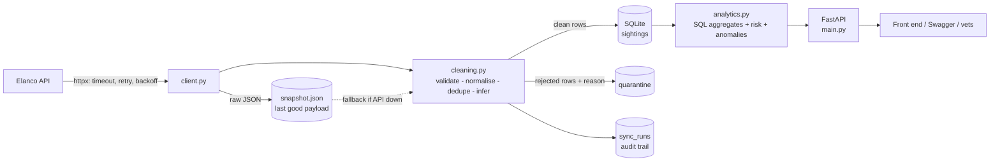
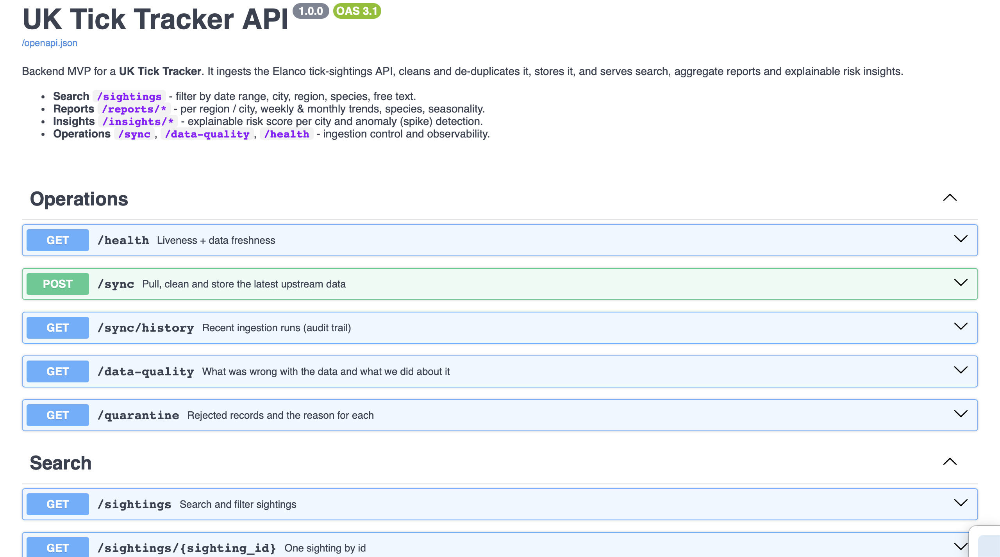
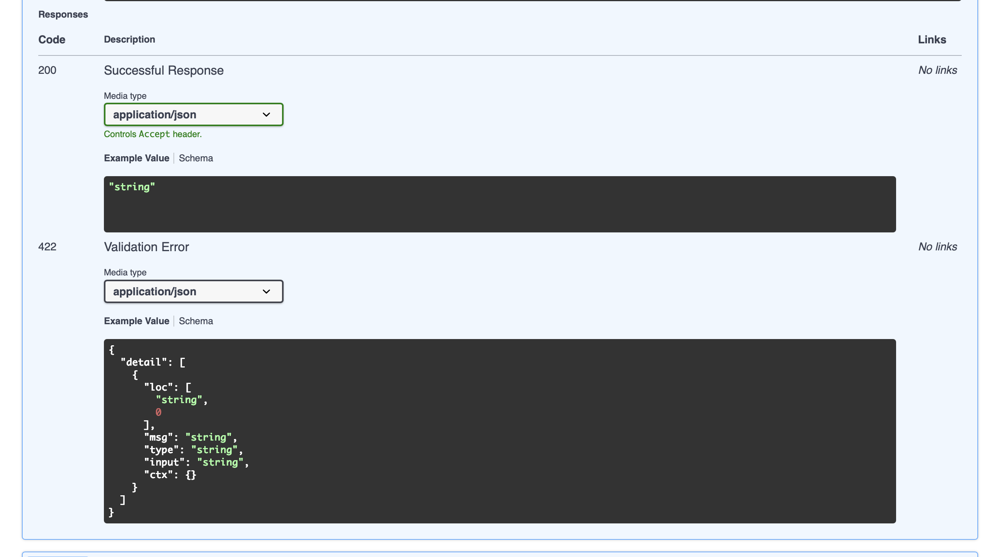
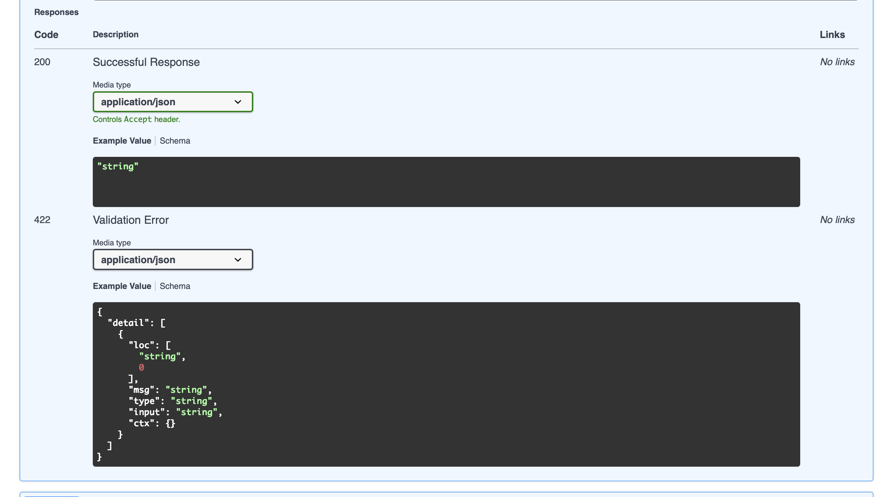
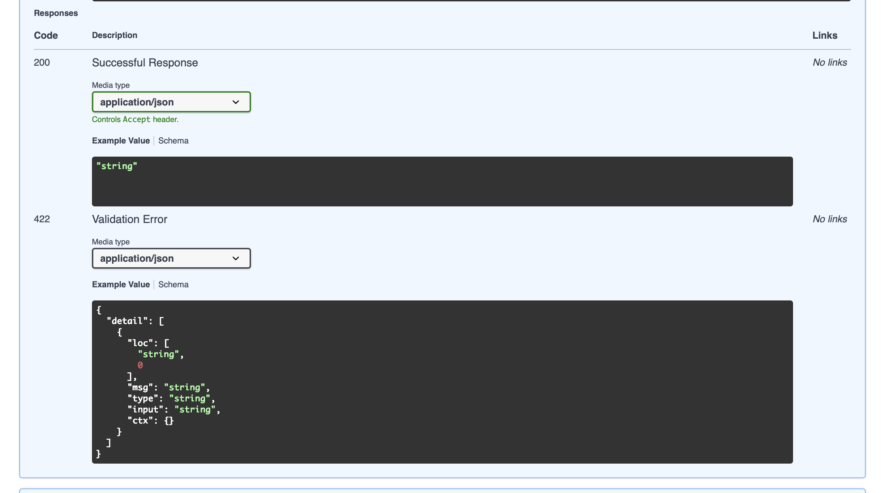

# UK Tick Tracker - Backend MVP

**Author:** Muhammad Hadi &nbsp;|&nbsp; Built for the Elanco Technical Task (Backend)

A backend service that ingests the Elanco tick-sightings API, cleans and de-duplicates it,
stores it, and serves **search**, **aggregate reports** and **explainable risk insights** so a
front end (or a vet / pet owner) can see where tick activity is rising across the UK.

> Python 3.11+ - FastAPI - SQLite - httpx - pytest (26 tests) - Docker - GitHub Actions CI

---------------------------------------------------------------------------------------

## 1. Run it (macOS / Linux)

```bash
git clone <this-repo-url> && cd tick-tracker-backend
python3 -m venv .venv && source .venv/bin/activate
pip install -r requirements.txt

uvicorn app.main:app --reload
```

Open **http://127.0.0.1:8000/docs** (interactive Swagger UI). On first start the service pulls
the upstream data automatically; `POST /sync` re-pulls on demand.

```bash
pytest -q                                   # run the test suite
python scripts/profile_data.py sightings.json   # profile a downloaded payload
docker build -t tick-tracker . && docker run -p 8000:8000 tick-tracker   # optional
```

Configuration is via `TICK_*` environment variables or a `.env` file (see `.env.example`).

## 2. What the upstream API gives us

`GET https://dev-task.elancoapps.com/data/tick-sightings` returns a flat JSON array (~1000 rows, no auth, no pagination):

```json
{"id": "02WNholuSg6ndCk4c1dA", "date": "2022-08-01T06:40:31", "latinName": "Ixodes apronophorus",
 "location": "Manchester", "species": "Marsh tick"}
```

There are no coordinates, only a **city name**, so "region" is derived by mapping each city to its UK region/nation (`app/regions.py`).

## 3. Architecture



| File | Responsibility |
|---|---|
| `app/client.py` | Resilient upstream client (retries, backoff + jitter, `Retry-After`, pagination-ready) |
| `app/cleaning.py` | Validation, normalisation, de-duplication, gap inference |
| `app/ingest.py` | The pipeline: fetch -> snapshot -> clean -> upsert -> audit |
| `app/db.py` | SQLite schema, idempotent upserts, query builder |
| `app/analytics.py` | Reports, trends, seasonality, risk score, anomaly detection |
| `app/errors.py` | One error envelope for every failure |
| `app/main.py` | FastAPI app + endpoints |

### Key decisions (and why)

* **FastAPI** - typed request validation, automatic OpenAPI docs, async client support.
* **Ingest into a local DB instead of proxying the API on every request.** Filters, aggregates and trends run as indexed SQL in milliseconds, the service keeps working when the upstream is down, and we never hammer the source API.
* **SQLite for the MVP.** Zero setup, real SQL, WAL mode. The schema is plain SQL, so moving to Postgres (plus PostGIS once coordinates exist) is a driver swap.
* **Derived columns at ingest** (`month`, `iso_week`, `week_start`, `region`): weekly/monthly trends become a cheap `GROUP BY` instead of date maths per request.
* **Explainable insights over a black-box model.** ~1000 rows with no coordinates or weather is too little to defend an ML model; a transparent score with visible components is more honest and reviewable.

## 4. Data handling: large data, duplicates, incomplete data

**Scale.** Rows are processed in batches of 500 with `executemany`; lookups use indexed `IN` queries; the upsert only *writes* rows that are new or changed. The client already follows `{"items": [...], "next": ...}` pagination so it keeps working if the API grows pages. For millions of rows the next steps are streaming ingestion and Postgres (see section 9).

**Idempotent syncs.** `id` is the primary key and writes are upserts, so running `/sync` twice never duplicates anything (`inserted / updated / unchanged` counts are reported).

**Duplicates** are detected three ways, and each is *quarantined with a reason*, never silently dropped:

| Reason | Meaning |
|---|---|
| `duplicate_exact` | Same id, identical content, repeated in the payload |
| `duplicate_id_conflict` | Same id, but different content (first one wins, conflict is visible) |
| `duplicate_content` | Same date + city + species under a different id - in this payload *or already stored by an earlier sync* |

**Incomplete / inconsistent data** - policy:

| Problem | Action |
|---|---|
| Missing/blank `id`, unparseable or missing `date`, date in the future, missing `location` | **Reject** to quarantine (`missing_id`, `invalid_date`, `missing_date`, `future_date`, `missing_location`) - these break every query |
| Missing `species` or `latinName` | **Keep**; infer from the other field when the mapping is unambiguous (`species_inferred`, `latin_name_inferred`), otherwise flag (`missing_species`, `missing_latin_name`) |
| Odd casing / whitespace / city aliases (`" newcastle "`) | **Normalise** (`location_normalised`) |
| City we can't map to a region | **Keep**, region `Unknown`, flagged `unknown_region` |
| Dates in mixed formats / timezones | Parsed to naive UTC |

Everything is inspectable: `GET /data-quality` (summary), `GET /quarantine?reason=...` (the rejected rows themselves), `GET /sync/history` (audit trail of every run).

## 5. Error handling

* **Upstream failures:** hard timeouts; retries with exponential backoff + jitter on timeouts, connection errors, 5xx and truncated JSON; `Retry-After` honoured on 429; 4xx fail fast (retrying can't help).
* **Graceful degradation:** every good payload is saved atomically as `data/snapshot.json`. If the API is down, `POST /sync` falls back to the snapshot (status `degraded`) and the service keeps serving data. With no snapshot it returns a clean `502`.
* **Never blocks startup:** if the first sync fails the API still starts and `/health` reports `degraded`.
* **Completeness check:** compares rows received with the API's own `/stats` total and notes any mismatch.
* **One error format everywhere:**
```json
{"error": {"code": "validation_error", "message": "Invalid request parameters",
           "details": [{"field": "start_date", "problem": "..."}], "request_id": "f1a4e057a560"}}
```
Codes: `validation_error` (422), `not_found` (404), `sync_in_progress` (409), `upstream_unavailable` (502), `internal_error` (500). Every response carries `X-Request-ID` for log correlation.

## 6. Endpoints

| Method | Path | Purpose |
|---|---|---|
| GET | `/sightings` | **Search/filter**: `start_date`, `end_date`, `location`, `region`, `species`, `q`, `sort`, `limit`, `offset` |
| GET | `/sightings/{id}` | One sighting |
| GET | `/locations` | Cities with region + count |
| GET | `/reports/regions?group_by=region\|city` | **Sightings per region** (count, share %, first/last, top species) |
| GET | `/reports/trends?interval=week\|month` | **Trends over time** with % change, 3-period moving average, zero-filled gaps |
| GET | `/reports/species` | Species breakdown |
| GET | `/reports/seasonality` | Busiest months (seasonal index) |
| GET | `/insights/risk` | **Extension:** explainable risk score per city |
| GET | `/insights/anomalies` | **Extension:** spike detection |
| POST | `/sync` | Pull + clean + store latest data |
| GET | `/sync/history`, `/data-quality`, `/quarantine`, `/health` | Observability |

All report endpoints accept the same date / location / region / species filters as `/sightings`.

```bash
curl "localhost:8000/sightings?location=Manchester&start_date=2021-01-01&end_date=2021-12-31"
curl "localhost:8000/reports/trends?interval=month&region=Scotland"
curl "localhost:8000/insights/risk?limit=5"
```

## 7. The AI/analytics extension

**Risk score (0-100) per city** - deliberately transparent:

```
score = 100 x (0.50 x volume + 0.25 x growth + 0.25 x seasonality)
volume       sightings in the last N days / the busiest city's       (0..1)
growth       last window vs previous window  (-100% -> 0, flat -> 0.33, +200% -> 1)
seasonality  how busy this calendar month usually is for the city    (2x average -> 1)
```

Each result returns the components, the raw evidence and a plain-English `explanation`, plus a `confidence: low` flag when a city has <10 sightings. The reference date defaults to the latest sighting in the data, so it also works on historical datasets.

**Anomaly detection** - monthly counts per series (overall / region / city) are scored with a z-score; months with `z >= 2` (and at least 3 sightings) are flagged `moderate`, `z >= 3` `high`.

Why not ML? With ~1000 rows and no coordinates / weather / habitat features, a trained model would overfit and be impossible to explain to a vet. The weights are a starting point to be **calibrated against outcome data** (e.g. confirmed Lyme cases).

## 8. Testing

`pytest -q` runs 26 tests with **no network access**: a scriptable fake upstream injects 500s, 429s with `Retry-After`, dropped connections and truncated JSON. Covered: cleaning rules, every rejection reason, cross-sync duplicates, retry/backoff, snapshot fallback, 502 path, idempotent re-sync, filters/pagination, report maths, validation envelope, anomaly detection on an injected spike.

`scripts/mock_upstream.py` is a deliberately flaky fake API for live demos: `FAIL_RATE=0.6 uvicorn scripts.mock_upstream:app --port 9000`, then start the tracker with `TICK_API_BASE_URL=http://127.0.0.1:9000/data`.

## 9. What I'd do with more time

* **Postgres + PostGIS** and real coordinates (or geocoding) for radius/bounding-box search and maps; replace the hand-written city->region table with an authoritative gazetteer.
* **Scheduled incremental sync** (cron / Celery) with ETag / `updated_since`, and a circuit breaker around the upstream.
* **Crowdsourced write path** (`POST /sightings`) with auth, rate limiting and spam/duplicate scoring.
* **Better ML:** add weather, habitat and population-density features; a Poisson / negative-binomial model with uncertainty; calibrate risk weights on health outcomes.
* **Production hardening:** Prometheus metrics, structured JSON logs, response caching, load tests, API versioning (`/v1`), Alembic migrations.
* **Front end** map and trend charts consuming these endpoints.

## 10. Screenshots







## 11. Findings on the provided dataset

The provided API returned 1000 records (2012-2024, 14 UK cities, 5 species). The profiler found no duplicates, no missing fields and no unparseable dates, and the count matched the API's own `/stats` total. The only normalisation applied was "Newcastle" -> "Newcastle upon Tyne" (57 records). The cleaning, quarantine and retry logic is therefore defensive: it is exercised by the test suite and by `scripts/mock_upstream.py`, which serves deliberately messy data and injects failures.
